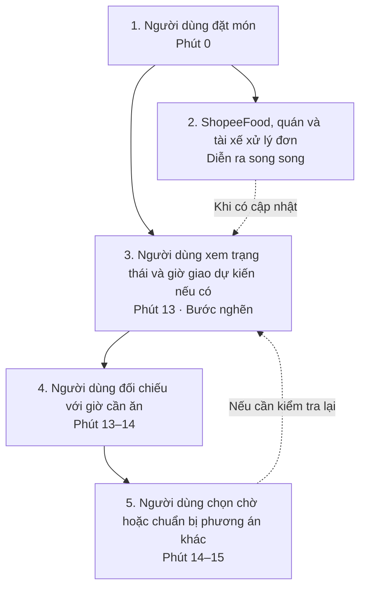
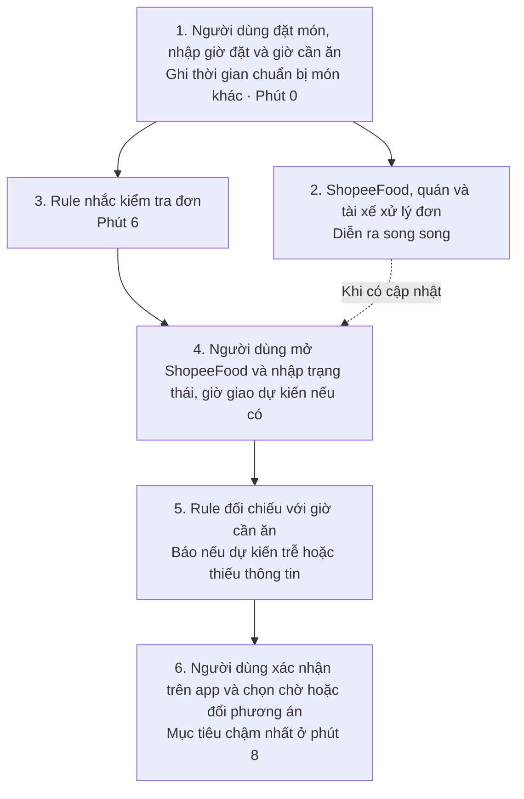

# Báo cáo nhóm — Day 02 Discovery & Problem Framing

## 1. Thông tin nhóm

- Tên nhóm: 911
- Thành viên: xem `TEAM.md`
- Candidate problem được chọn (1 câu): Khi đơn ShopeeFood chờ tài xế hoặc tiến độ chưa rõ, người đặt cần biết lúc nào nên kiểm tra và quyết định tiếp tục chờ hay đổi phương án ăn trước khi quá muộn.
- Quyết định cuối: Go — thử nghiệm nhỏ bằng Rule theo mốc thời gian, chưa triển khai dự báo bằng AI.

---

## 2. Hội tụ nhóm (CP3)

### 2.1. Pitch

| # | Người đưa ra | Candidate (Job Story ngắn) | Actor | Bottleneck | Câu hỏi phản biện nhận được (ai hỏi) |
|---:|---|---|---|---|---|
| 1 | Lê Quân Bảo | Khi cập nhật API endpoint mới ở backend, tôi muốn Swagger/Postman collection đồng bộ ngay kèm schema và ví dụ, để Frontend dev ghép API không bị lỗi | Backend Dev | Bước viết mô tả params & tạo ví dụ JSON thực tế (15–20 phút/lần) | "Nếu dev chịu khó viết XML comment chuẩn trong code để Swagger tự trích xuất thì cần gì AI nữa?" (Minh hỏi) |
| 2 | Lê Quân Bảo | Khi QA trả về bug ticket ghi chung chung "nút bấm không chạy", tôi muốn trích xuất nhanh payload và stack trace tương ứng trong log, để sửa ngay mà không phải nhờ thao tác lại | Backend Dev | Bước trao đổi và đứng nhìn QA thao tác lại trên màn hình (15–20 phút/lần) | "Nếu QA không ghi rõ mốc thời gian hay tài khoản test, làm sao dev lọc ra đúng đoạn log bị lỗi giữa hàng nghìn request?" (Quang hỏi) |
| 3 | Lê Quân Bảo | Khi nhận một module mới trong dự án legacy, tôi muốn nắm nhanh Data Flow giữa các tầng Controller-Service-Repo-DB, để bắt tay vào sửa bug/viết code đúng chỗ | Dev mới vào dự án | Bước dò Call Hierarchy và debug trace dữ liệu qua nhiều tầng (12–16 tiếng) | "Dự án lớn có hàng trăm file và logic ngầm trong SQL/Trigger thì làm sao tránh bị tràn context hoặc AI hiểu sai luồng?" (Hậu hỏi) |
| 4 | Nguyễn Văn Hậu | Khi khách nhắn hỏi giá sỉ/lẻ qua Zalo/FB, tôi muốn bóc tách đúng mã hàng và tra tồn kho/chiết khấu để gửi báo giá trong 2 phút, giúp chốt đơn kịp thời | Nhân viên CSKH / Sale shop SME | Bóc tách tên hàng gõ tắt để tra mã SKU trong Sheets và tính bậc chiết khấu (3,5–4,5 phút/lần) | "Nếu chỉ chuẩn hóa file Google Sheets dùng hàm tìm kiếm và tính sẵn công thức (Rule/No AI) thì đã giải quyết được 70–80% thời gian chưa?" (Bảo hỏi) |
| 5 | Nguyễn Văn Hậu | Khi tìm kiếm việc làm, tôi muốn quét và đối chiếu tự động JD mới từ nhiều trang với CV cá nhân, để chọn ra việc phù hợp nộp trong ngày mà không cần mở hàng chục tab | Ứng viên IT / Fresher | Mở 20–30 tab đọc lướt nội dung, bóc tách yêu cầu kinh nghiệm thật và so khớp với CV (45–60 phút/ngày) | "Các trang tuyển dụng lớn đều chặn bot cào dữ liệu (anti-scraping), liệu giải pháp có lấy được dữ liệu JD sạch và đều đặn không?" (Kim hỏi) |
| 6 | Nguyễn Văn Hậu | Khi có thông báo học vụ, lịch thi từ Portal trường, LMS và email, tôi muốn biết ngay các mốc hạn chót trong tuần, để nộp bài đúng hạn | Sinh viên / Học viên | Đăng nhập 4–5 hệ thống rời rạc, đọc thông báo dài và đối chiếu ngày giờ hạn chót (15–20 phút/ngày) | "Cơ chế bảo mật SSO và Captcha của cổng thông tin trường có cho phép tool tự động kết nối kéo thông báo về an toàn không?" (Quang hỏi) |
| 7 | Trần Quang Minh | Khi nhận hàng tại khu nhiều tòa nhà, tôi muốn xác định chính xác điểm gặp shipper, để nhận kiện hàng mà không phải gọi điện và đi tìm nhiều lần | Người nhận hàng chung cư | Đi tìm nhau và xác định điểm nhận hàng sau khi shipper báo đến (10 phút) | "Nếu khu chung cư đã có sảnh đón hoặc bàn bảo vệ giữ hàng cố định (Rule/No AI) thì người nhận có cần AI chỉ điểm gặp không?" (Bảo hỏi) |
| 8 | Trần Quang Minh | Khi đặt món trên ShopeeFood lúc cần ăn đúng giờ, tôi muốn biết sớm đơn có tài xế nhận hay nguy cơ bị hủy, để kịp đổi phương án ăn uống khác | Người đặt món online | Khoảng thời gian chờ quán/tài xế nhận đơn mà không rõ tiến độ và không có cảnh báo trễ | "Ngoài chuyện kẹt xe, việc quán hết món hoặc đóng cửa đột xuất cũng gây hủy đơn, AI có phân biệt được rủi ro thiếu tài xế do giao thông với lỗi từ phía quán không?" (Hậu hỏi) |
| 9 | Trần Quang Minh | Khi đến căng tin vào giờ nghỉ giữa buổi, tôi muốn biết việc xếp hàng và nhận món mất bao lâu, để chọn thời điểm ăn phù hợp không bị muộn học | Sinh viên ăn trưa/nghỉ giữa giờ | Đoạn từ lúc vào hàng đến lúc nhận món mất 11 phút (chưa tách được xếp hàng hay chờ làm món) | "Thời gian làm món phụ thuộc vào bếp, liệu camera đếm người xếp hàng (Rule/CV) hay bảng ước lượng giờ cao điểm thông thường đã đủ giải quyết chưa?" (Kim hỏi) |
| 10 | Nguyễn Hải Quang | Khi so sánh các phòng trọ vừa túi tiền, tôi muốn biết mỗi phòng thực sự tốn bao nhiêu/tháng, để chọn phòng đi xem phù hợp với ngân sách | Người tìm phòng trọ | Nhắn/gọi hỏi chủ trọ về các khoản phí ẩn chưa rõ trong tin đăng và chờ phản hồi (45 phút) | "Việc chủ trọ trả lời chậm hoặc giấu phí phát sinh là rào cản con người ngoài đời thực, liệu AI hay tool có giúp họ phản hồi nhanh hơn được không?" (Bảo hỏi) |
| 11 | Nguyễn Hải Quang | Khi mua nguyên liệu nấu ăn cho một người, tôi muốn biết cần mua bao nhiêu, để dùng hết trước khi rau củ bị hỏng | Người sống một mình tự nấu | Khâu chọn lượng thực mua tại siêu thị/cửa hàng vì gói đóng sẵn thường vượt quá khẩu phần một bữa (30–50 phút) | "Lượng ăn phụ thuộc vào số người và sức ăn từng hôm; nếu siêu thị chỉ bán gói lớn đóng sẵn thì AI gợi ý khẩu phần có giúp giảm lượng rau thừa bị bỏ đi không?" (Minh hỏi) |
| 12 | Nguyễn Hải Quang | Khi chuẩn bị ứng tuyển vị trí thực tập/entry-level, tôi muốn biết dự án nào của mình khớp với từng yêu cầu trong JD, để chọn nội dung đưa vào CV | Sinh viên năm cuối / Fresher | Bước đối chiếu từng yêu cầu trong JD với các việc đã làm trong các dự án cũ (30–40 phút) | "Nếu ứng viên chỉ có 2–3 dự án học tập quen thuộc, việc tự đọc và chọn bằng mắt mất khoảng 15 phút, liệu có đáng phải dùng AI can thiệp không?" (Hậu hỏi) |
| 13 | Nguyễn Bá Kim | Khi nhận thông báo từ nhiều nền tảng (LMS, Teams, Email), tôi muốn xem tất cả deadline ở một nơi, để không bị bỏ sót bài tập | Sinh viên đại học | Mở lần lượt 3–4 ứng dụng để đọc và ghi chú deadline thủ công (15–20 phút/ngày) | "Nếu bạn bè spam mail hoặc nhắn rủ 'mai 9h đi đá banh, 10h đi bơi', làm sao AI phân biệt được đâu là deadline học tập thật để không đưa nhầm vào lịch?" (Bảo hỏi) |
| 14 | Nguyễn Bá Kim | Khi cần tài liệu học tập trước giờ học, tôi muốn tìm thấy file bài giảng/tài liệu nhanh chóng, để tiết kiệm thời gian chuẩn bị bài | Sinh viên đại học | Tìm kiếm rời rạc trên Email, Teams, Drive và nhắn hỏi bạn bè (10–30 phút/lần) | "Drive và Teams vốn đã có thanh tìm kiếm theo tên, công cụ này sẽ tìm theo ngữ cảnh hay tóm tắt nội dung bên trong file như thế nào để người dùng không phải mở từng file lên xem?" (Quang hỏi) |
| 15 | Nguyễn Bá Kim | Khi kết thúc buổi họp nhóm làm bài tập, tôi muốn có biên bản tóm tắt tự động, để tiết kiệm thời gian tổng hợp và không sót việc | Nhóm trưởng / Leader | Nghe lại nội dung, lọc ý chính và gõ văn bản biên bản phân công công việc (30–60 phút/buổi) | "Cuộc họp sinh viên thường có nhiều tạp âm, nói chêm tiếng lóng hoặc chen ngang, liệu transcript có đủ sạch để AI tóm tắt đúng việc không?" (Minh hỏi) |
### 2.2. Cluster

| Cluster | Các candidate | Pattern chung |
|---|---|---|
| A — Gom & đồng bộ thông tin rải rác | #6 (Hạn chót học vụ), #10 (Tổng hợp phí thuê trọ), #13 (Deadline từ LMS/Teams), #14 (Tìm tài liệu học tập), #15 (Biên bản họp nhóm) | Dữ liệu/thông báo phân tán ở nhiều kênh khác nhau, phải mở từng công cụ đọc và tự ghi chép thủ công |
| B — Lệch pha giao tiếp & đối chiếu dữ liệu nghiệp vụ | #1 (Swagger/Postman cho FE), #2 (Log/Payload tái hiện bug QA), #4 (Tra mã SKU & báo giá sỉ/lẻ Zalo) | Hai bên Dev–FE, Dev–QA, Khách–Sale dùng ngôn ngữ/công cụ khác nhau, mất thời gian tra cứu và giải thích qua lại |
| C — So khớp ngữ cảnh văn bản (Matching) | #5 (Quét JD so khớp với CV), #12 (Ghép yêu cầu JD với minh chứng dự án cũ) | Đối chiếu tiêu chí giữa hai tập tài liệu không có cấu trúc cố định để tìm điểm tương đồng |
| D — Chờ và quyết định trong quy trình dịch vụ | #7 (Điểm hẹn shipper ở chung cư), #8 (Theo dõi đơn ShopeeFood), #9 (Xếp hàng căng tin) | Người dùng thiếu thông tin đúng lúc để quyết định chờ tiếp hay đổi phương án. |
| E — Hiểu hệ thống phần mềm | #3 (Trace data flow code cũ) | Người mới phải lần theo các tầng hệ thống trước khi sửa lỗi. |
| F — Định lượng nhu cầu cá nhân | #11 (Khẩu phần nguyên liệu nấu ăn) | Người mua khó chọn lượng phù hợp khi gói hàng có kích thước cố định. |

### 2.3. Opportunity Solution Tree rút gọn

Gốc là **1 outcome**. Nhánh là **opportunity** (nhu cầu, pain), không phải tính năng hay công cụ.

```text
OUTCOME: Người đặt ShopeeFood đưa ra quyết định có căn cứ trước hạn cần đổi phương án ăn.

├── Opportunity: Người dùng chưa biết khi nào nên kiểm tra lại nếu đơn vẫn đang chờ tài xế.
├── Opportunity: Khi thiếu giờ giao dự kiến hoặc trạng thái tài xế, người dùng khó đối chiếu với giờ cần ăn.
└── Opportunity: Người dùng cần biết còn bao lâu để chuẩn bị phương án ăn khác trước khi lựa chọn bị thu hẹp.
    X "Tích hợp Google Maps API kiểm tra kẹt xe"   ← solution, gạch khỏi tầng này
    X "Nút tự động hủy đơn sau 10 phút"            ← solution, gạch khỏi tầng này
    X "Chatbot tự động báo kẹt xe và gợi ý quán"   ← solution, gạch khỏi tầng này
```

Những ý đã gạch bỏ vì là solution đội lốt opportunity:

- "Tích hợp Google Maps API kiểm tra kẹt xe": Đây là giải pháp tích hợp công cụ kỹ thuật của bên thứ ba, không phải nhu cầu hay nỗi đau thực tế của người dùng.
- "Nút tự động hủy đơn sau 10 phút": Đây là tính năng/quy tắc hệ thống do người làm giải pháp tự nghĩ ra, không phải nhu cầu người dùng. Quyền hủy còn phụ thuộc trạng thái đơn.
- "Chatbot tự động báo kẹt xe và gợi ý quán": Đây là giải pháp AI/giao diện bị cài cắm quá sớm trước khi xác định rõ ranh giới vấn đề.


### 2.4. Chấm điểm shortlist (1–5)

| Candidate | Actor rõ | Quy trình rõ | Pain có bằng chứng | Impact đo được | Vừa sức lab | So sánh được No AI/Rule/Workflow/Agent | Nhóm hiểu domain | Tổng |
|---|---:|---:|---:|---:|---:|---:|---:|---:|
| Hỗ trợ quyết định khi đơn ShopeeFood chờ tài xế hoặc tiến độ chưa rõ | 5 | 4 | 5 | 5 | 4 | 5 | 5 | **33** |
| Đồng bộ API Swagger/Postman cho Frontend | 5 | 5 | 4 | 4 | 5 | 5 | 4 | **32** |
| Bóc tách mã SKU và tính giá sỉ/lẻ từ tin nhắn Zalo | 4 | 4 | 4 | 4 | 4 | 4 | 3 | **27** |

**Candidate được chọn:**
Hỗ trợ người đặt ShopeeFood quyết định tiếp tục chờ hay đổi phương án ăn khi đơn chờ tài xế hoặc tiến độ chưa rõ.

**Vì sao chọn:**
Ở thời điểm chọn candidate, thành viên đề xuất #8 đã kể một đơn chờ 30–45 phút mới có tài xế và một đơn khác tự hủy sau 1–2 giờ. Nhóm có thể kiểm chứng thêm với người đặt món ngoài nhóm và đo bước ra quyết định khi tiến độ đơn chưa rõ. CP4 bổ sung ba trường hợp chờ 50, 120 và 40 phút với mốc kết thúc khác nhau. Các lời kể chưa đủ để kết luận nguyên nhân là giao thông, quán đông hay thuật toán phân tài xế. Phạm vi này cho phép so sánh No AI, Rule, Workflow và Agent trên cùng một bước hỗ trợ người dùng.

**Vì sao loại các candidate còn lại:**
- *Đồng bộ API Swagger/Postman:* Có quy trình rõ, nhưng nhóm chọn kiểm chứng #8 vì đã tiếp cận được người đặt món ngoài nhóm và có thể hỏi về một đơn cụ thể. Điểm số hai candidate sát nhau; bảng điểm không chứng minh #1 kém quan trọng.
- *Bóc tách SKU & báo giá sỉ Zalo:* Cần mẫu tin nhắn, bảng mã hàng và quy tắc chiết khấu thật của một shop để kiểm chứng; nhóm chưa có các đầu vào đó.

**Xử lý bất đồng (nếu có):**
Bảo và Kim nêu rủi ro thiếu dữ liệu vị trí tài xế và thuật toán điều phối của ShopeeFood để dự báo. Báo cáo ghi nhận ý kiến này và thu hẹp phạm vi sau CP4: thử Rule nhắc người dùng kiểm tra trạng thái và đối chiếu với giờ cần ăn. Chưa có bằng chứng để tính xác suất tài xế từ chối đơn hay quy nguyên nhân cho giao thông.

---

## 3. Kiểm chứng + research giải pháp đã có (CP4)

### 3.1. Assumption Map

Candidate dùng cho CP4: **#8 — người đặt ShopeeFood cần biết sớm tình trạng tài xế/đơn để quyết định tiếp tục chờ hay đổi cách ăn**. Các điểm 1–5 dưới đây là mức ưu tiên kiểm chứng của nhóm, không phải kết quả khảo sát.

| # | Giả định | Loại (Value / Usability / Feasibility / Viability) | Quan trọng (1–5) | Đã có bằng chứng (1–5) | Kiểm chứng trước? |
|---:|---|---|---:|---:|---|
| 1 | Người đặt khác ngoài nhóm cũng từng chờ lâu để có tài xế hoặc phải tự hủy sau khi chờ. | Value | 5 | 2 | **Có — hỏi người ngoài nhóm** |
| 2 | Trong lần chờ lâu, khoảng không biết nên tiếp tục chờ hay đặt lại là pain chính; người dùng không chỉ khó chịu vì tổng thời gian giao hàng dài. | Value | 5 | 1 | **Có — hỏi hành vi lần gần nhất** |
| 3 | Trạng thái đơn và thông báo hiện có chưa đủ giúp người dùng nhận ra sớm việc không có tài xế hoặc đơn bị hủy. | Usability | 5 | 1 | **Có — đối chiếu màn hình và cài đặt thông báo** |
| 4 | Có thể lấy mốc đặt đơn, có tài xế, lấy món, hủy và nhận món từ lịch sử đơn hoặc ảnh chụp để phân biệt nơi chậm. | Feasibility | 5 | 1 | **Có — kiểm một đơn thực tế** |
| 5 | Quán đông là nguyên nhân trực tiếp của các đơn không có tài xế hoặc bị hủy mà người dùng kể. | Feasibility | 3 | 1 | Chưa kết luận; kiểm theo từng đơn, tránh suy từ trùng thời điểm. |
| 6 | Lời nhắc kiểm tra và đối chiếu với hạn ăn giúp người dùng quyết định sớm hơn dù phải nhập trạng thái thủ công. | Viability | 4 | 1 | Kiểm bằng pilot ở CP6. |

**Ưu tiên kiểm chứng:** giả định 1–4 có độ quan trọng cao nhưng bằng chứng còn mỏng. Trong ba người ngoài nhóm, một người chờ 50 phút đến khi có tài xế; hai người chờ 120 phút và 40 phút rồi tự hủy. Lời kể của thành viên đề xuất #8 về đơn ngày 07/11/2026 cho thêm một trường hợp: đặt khoảng 18:00, nhận khoảng 20:00, chờ tài xế nhận 30–45 phút. Chưa có lịch sử đơn để tách thời gian quán chuẩn bị, tài xế lấy món và di chuyển.

### 3.2. Kiểm chứng

Cách đã dùng: **hỏi riêng ba người đặt món ngoài nhóm qua tin nhắn**, tổng hợp câu trả lời, đối chiếu lời kể của thành viên đề xuất #8 và tra cứu tài liệu công khai. Không tính thành viên đề xuất #8 vào ba người được hỏi.

**Ghi chép lời kể của thành viên đề xuất #8 (hỏi qua trao đổi ngày 09/11/2026; không tính là phỏng vấn CP4):** Đơn ngày 07/11/2026 đặt khoảng 18:00, nhận khoảng 20:00; người đặt nhớ chờ có tài xế khoảng 30–45 phút, mở app kiểm tra liên tục, hỏi tài xế và tiếp tục đợi. Ở một đơn khác, người đặt nói sau khoảng 1–2 giờ vẫn thấy đơn đang chờ, chưa ai nhận, không thấy cảnh báo nên tự hủy. Chưa nhớ ngày/mã đơn thứ hai, số lần mở app, thời điểm hỏi tài xế, trạng thái chính xác của đơn đầu hoặc mốc tài xế lấy món. “Không thấy cảnh báo” là điều người dùng quan sát, chưa chứng minh ứng dụng không gửi thông báo.

**Đối chiếu nguồn công khai:** [Trung tâm trợ giúp ShopeeFood về hủy đơn](https://help.shopee.vn/portal/4/article/79383) cho biết nút hủy ở trang chi tiết đơn có thể bị mờ tùy trạng thái quán hoặc tài xế. Đây là hướng dẫn chính sách, không phải bằng chứng về thời điểm người được hỏi nhìn thấy thông báo. Vì vậy, khi đề xuất đổi phương án ăn cần kiểm tra quyền hủy thực tế của đơn đang chờ.

**Câu hỏi đã dùng để hỏi về lần đã xảy ra** (không giới thiệu giải pháp trước):

1. Lần gần nhất bạn đặt đồ ăn mà nhận muộn hoặc đơn bị hủy là khi nào? Bạn nhớ giờ đặt, giờ có tài xế, giờ nhận/hủy không?
2. Trong lúc chờ, bạn đã thấy trạng thái gì trên ứng dụng? Bạn mở kiểm tra hoặc liên hệ quán/tài xế bao nhiêu lần?
3. Bạn nhận ra mình nên tiếp tục chờ hay đổi cách ăn lúc nào? Sau đó bạn đã làm gì?
4. Nếu lần đó không gây trở ngại, vì sao? Có thông báo hoặc cách xử lý nào đã đủ tốt?

Để kiểm tra lại dữ liệu, cần xin lịch sử đơn hoặc ảnh chụp màn hình nếu người tham gia đồng ý (che thông tin cá nhân trước khi lưu). Chưa lưu câu nói nguyên văn của từng người; không dựng thành trích dẫn. Không suy ra việc ứng dụng “không gửi thông báo” chỉ từ việc người dùng không thấy thông báo.

**Interview snapshot 1 — người ngoài nhóm**

| Trường | Nội dung |
|---|---|
| Người được hỏi (vai trò, không ghi tên thật) | Sinh viên thường đặt đồ ăn, ngoài nhóm; hỏi qua tin nhắn ngày 08/11/2026. Người trả lời cho biết đơn được đặt cùng ngày. |
| Câu nói đáng nhớ nhất (nguyên văn) | Chưa lưu nguyên văn; ý chính: trong lúc đợi không thấy thông báo từ ứng dụng. |
| Lần gần nhất gặp vấn đề này: chuyện gì đã xảy ra? | Chờ 50 phút đến khi có tài xế nhận. Người trả lời nói không thấy ứng dụng báo gì; chưa rõ là không có thông báo đẩy hay trạng thái màn hình không đổi. |
| Hiện đang xử lý bằng cách nào (workaround)? | Tiếp tục chờ. |
| Mất bao lâu, bao lần? | 50 phút chờ tài xế cho một đơn được kể; chưa ghi tần suất. |
| Insight / opportunity rút ra | Người dùng có thể cần biết sớm đơn sẽ còn chờ tài xế bao lâu; chưa rõ thông tin nào đã hiển thị hoặc đã được gửi. |

**Interview snapshot 2 — người ngoài nhóm**

| Trường | Nội dung |
|---|---|
| Người được hỏi (vai trò, không ghi tên thật) | Người đặt món ngoài nhóm; hỏi qua tin nhắn ngày 07/11/2026. |
| Câu nói đáng nhớ nhất (nguyên văn) | Chưa lưu nguyên văn. |
| Lần gần nhất gặp vấn đề này: chuyện gì đã xảy ra? | Chờ khoảng 120 phút rồi tự hủy đơn. Không nhớ trạng thái chi tiết trên ứng dụng. |
| Hiện đang xử lý bằng cách nào (workaround)? | Tiếp tục đợi dù khó chịu; cuối cùng tự hủy. |
| Mất bao lâu, bao lần? | 120 phút từ lúc đặt đến lúc tự hủy trong một trường hợp được kể; chưa ghi tần suất. |
| Insight / opportunity rút ra | Chờ kéo dài đến lúc hủy là dấu hiệu cần kiểm tra xem người dùng có còn đủ thời gian đổi cách ăn hay không. |

**Interview snapshot 3 — người ngoài nhóm**

| Trường | Nội dung |
|---|---|
| Người được hỏi (vai trò, không ghi tên thật) | Người đặt món ngoài nhóm; hỏi qua tin nhắn ngày 07/11/2026. |
| Câu nói đáng nhớ nhất (nguyên văn) | Chưa lưu nguyên văn. |
| Lần gần nhất gặp vấn đề này: chuyện gì đã xảy ra? | Chờ khoảng 40 phút rồi tự hủy đơn. Không nhớ trạng thái chi tiết trên ứng dụng. |
| Hiện đang xử lý bằng cách nào (workaround)? | Tiếp tục đợi dù khó chịu; cuối cùng tự hủy. |
| Mất bao lâu, bao lần? | 40 phút từ lúc đặt đến lúc tự hủy trong một trường hợp được kể; chưa ghi tần suất. |
| Insight / opportunity rút ra | Dù thời gian chờ ngắn hơn người số 2, người dùng vẫn phải tự xác định lúc nên dừng chờ. |

Tổng hợp:

| Nguồn | Số người / số mẫu | Tín hiệu xác nhận | Tín hiệu phản bác |
|---|---:|---|---|
| Ba người ngoài nhóm được hỏi riêng qua tin nhắn | 3 | Một người chờ 50 phút đến khi có tài xế; hai người chờ 120 và 40 phút rồi tự hủy. | Cả ba chưa có log đơn hoặc câu nguyên văn. Hai người tự hủy vẫn tiếp tục đợi đến lúc khó chịu, nên chưa biết lời nhắc sớm có làm họ đổi quyết định hay không. Không đủ để kết luận thông báo của ứng dụng không hoạt động. |
| Lời kể thành viên đề xuất candidate #8 (chỉ làm dữ liệu khởi đầu, không tính là mẫu CP4) | 1 người, 2 đơn được kể | Đơn ngày 07/11/2026 mất khoảng 120 phút, chờ tài xế nhận 30–45 phút. Đơn khác sau khoảng 1–2 giờ vẫn chưa ai nhận; người đặt không thấy cảnh báo và tự hủy. | Chưa có log đơn, chưa biết vì sao không thấy cảnh báo; không chứng minh người khác gặp tương tự. |

**Nhóm đã sửa problem thế nào sau kiểm chứng:** Một người chờ 50 phút đến khi có tài xế; hai người chờ 120 và 40 phút rồi tự hủy. Vì chưa ai cung cấp log thông báo, nhóm thu hẹp phát biểu thành: **khi tiến độ đơn chưa rõ, người đặt cần biết lúc nào nên kiểm tra và quyết định tiếp tục chờ hay đổi kế hoạch ăn.** Không kết luận mọi đơn chậm đều do thiếu tài xế hoặc ứng dụng không gửi thông báo. Tín hiệu phản bác cần kiểm tiếp: hai người vẫn chọn đợi dù khó chịu; có thể lời nhắc sớm không thay đổi hành vi, hoặc họ không còn quyền hủy ở thời điểm được nhắc.

### 3.3. Research giải pháp đã có

| Công cụ / case / pattern | Link | Giải bước nào trong quy trình? | Điểm mạnh | Khoảng trống / rủi ro | Bài học cho nhóm |
|---|---|---|---|---|---|
| ShopeeFood: quy trình xử lý đơn bị hủy vì không tìm được tài xế | [Hướng dẫn chính thức cho quán](https://merchant.shopeefood.vn/edu/article/lam-the-nao-de-gui-yeu-cau-hoan-tien-don-huy-boi-shopeefood-do-khong-co-tai-xe) | Xử lý nhánh đơn hủy sau khi không có tài xế nhận. | Xác nhận đây là một loại đơn hủy có quy trình chính thức, giúp tách khỏi nhánh đã có tài xế nhưng giao muộn. | Tài liệu dành cho quán, không mô tả lúc nào khách nhìn thấy thông báo hoặc tỷ lệ đơn gặp trường hợp này. | Hỏi và đo riêng từng loại đơn; không dùng tài liệu của quán để kết luận trải nghiệm của khách. |
| ShopeeFood: thao tác hủy đơn phía khách | [Trung tâm trợ giúp ShopeeFood](https://help.shopee.vn/portal/4/article/79383) | Khách có thể bấm hủy ở trang chi tiết đơn khi trạng thái cho phép; sau khi quán xác nhận/chuẩn bị hoặc tài xế đang giao, nút có thể bị mờ. | Cho thấy quyết định đổi kế hoạch ăn cần gắn với **trạng thái đơn và quyền hủy thực tế**. | Hướng dẫn không cho biết khách đã được báo trạng thái kịp thời hay chưa, và không bảo đảm hoàn tiền ngay. | Đừng đề xuất cảnh báo “đặt lại ngay” khi đơn cũ chưa hủy được; cần chỉ rõ bước hỗ trợ tương ứng. |
| Uber Eats: màn hình theo dõi đơn giao muộn | [Uber Eats Help — Delayed Order Arrival](https://help.uber.com/ubereats/stores/article/delayed-order-arrival?nodeId=d538046f-41e6-46bc-96c4-25c548d8f0b2) | Hiển thị giờ giao ước tính có thể thay đổi và mốc “Latest arrival by”; hướng dẫn liên hệ hỗ trợ khi quá mốc. | Là ví dụ tách thời gian ước tính và mốc muộn nhất để người dùng biết khi nào cần hành động. | Hai mốc vẫn là dự báo, không bảo đảm giờ giao; chính sách hủy/chi phí thay đổi theo trạng thái đơn và nền tảng, không thể áp nguyên cho ShopeeFood. | So sánh cách hiện trạng thái và mốc quyết định; thử trước phương án quy tắc/thông báo rõ ràng rồi mới cân nhắc dự báo. |

**Giả thuyết vai trò của AI để nhóm đánh giá ở CP6:** Nếu được ShopeeFood cung cấp dữ liệu vận hành theo thời gian thực và lịch sử đủ lớn, AI có thể dự báo (1) xác suất chưa có tài xế sau một ngưỡng thời gian và (2) nguy cơ đơn đến muộn so với giờ dự kiến. Hệ thống chỉ **cảnh báo sớm kèm mức tin cậy và trạng thái thực tế**; khách quyết định chờ, liên hệ hỗ trợ hoặc đổi kế hoạch. AI không tự hủy, tự đặt đơn khác hay khẳng định chắc chắn “sẽ không có tài xế”. Cần kiểm thử tỷ lệ cảnh báo đúng, cảnh báo nhầm, bỏ sót và số phút báo trước khi khách hết khả năng xử lý. Nhóm hiện không có dữ liệu điều phối để huấn luyện/kiểm thử dự báo, nên một bản thử nghiệm vừa sức lab có thể bắt đầu bằng quy tắc theo mốc trạng thái và thời gian chờ quan sát được; chưa thể kết luận AI tốt hơn quy tắc.

---

## 4. Quy trình trước/sau (CP5)

### 4.1. Quy trình hiện tại

**Hiện tại — 5 bước, 15 phút trong kịch bản tham chiếu, 4/5 bước thủ công.** Mốc 15 phút dùng để mô tả luồng và chưa phải số đo thực tế; CP6 sẽ đo baseline trên các đơn được theo dõi.



| Bước | Actor | Input | Output | Thời gian / tần suất | Ghi chú |
|---:|---|---|---|---|---|
| 1 | Người đặt món | Món đã chọn và thông tin giao hàng | Đơn đã đặt và giờ đặt | Phút 0, một lần mỗi đơn | Bắt đầu tính thời gian tại đây. |
| 2 | ShopeeFood, quán, tài xế | Đơn đã đặt | Trạng thái đơn khi có cập nhật | Thay đổi theo đơn, diễn ra song song với việc theo dõi | Chỉ ghi thông tin hiển thị cho người đặt. |
| 3 | Người đặt món | Chi tiết đơn hoặc thông báo | Trạng thái tài xế và giờ giao dự kiến nếu có | Phút 13 trong kịch bản, có thể lặp lại | Có thể thiếu thông tin để quyết định. |
| 4 | Người đặt món | Trạng thái đơn, giờ cần ăn và thời gian chuẩn bị món khác | Nhận định còn kịp chờ hay cần đổi phương án | Phút 13–14 trong kịch bản | Nếu thiếu giờ giao dự kiến, cân nhắc theo thời gian còn lại. |
| 5 | Người đặt món | Kết quả đối chiếu và phương án ăn khác | Quyết định chờ hoặc chuẩn bị món khác | Phút 14–15 trong kịch bản | Nếu tiếp tục chờ, quay lại bước 3 khi cần. |

**Bottleneck chính.** Ở bước 3–4, người dùng tự chọn lúc kiểm tra. Nếu chưa thấy tài xế nhận đơn hoặc chưa có giờ giao dự kiến, họ phải cân nhắc chờ thêm khi thời gian chuẩn bị món khác đang ngắn dần.

### 4.2. Quy trình tương lai

**Tương lai — 6 bước, mục tiêu quyết định trong tối đa 8 phút, 3/6 bước thủ công**



**Phân vai.** Rule nhắc kiểm tra và đối chiếu thông tin ở bước 3 và 5. Người đặt món nhập mốc giờ, kiểm tra app và quyết định ở bước 1, 4 và 6. Luồng thử dùng Rule, không có bước AI.

**Mốc nhắc.** Hạn đổi phương án là giờ muộn nhất để bắt đầu chuẩn bị món khác. Rule nhắc sau 6 phút kể từ lúc đặt, hoặc sớm hơn để chừa 2 phút trước hạn. Nếu còn dưới 2 phút, nhắc ngay. Ví dụ, đặt lúc **11h30**, cần ăn lúc **12h00** và cần **15 phút** để chuẩn bị món khác thì hạn đổi phương án là **11h45**. Lời nhắc đến lúc **11h36**, với mục tiêu quyết định chậm nhất lúc **11h38**.

**Cách đọc kết quả.** Nếu giờ giao dự kiến muộn hơn giờ cần ăn, Rule nhắc cân nhắc món khác. Nếu app chưa cho biết có tài xế hay chưa, hoặc chưa có giờ giao dự kiến, Rule hiện “chưa đủ thông tin” để người dùng cân nhắc theo thời gian còn lại.

**Boundary.** Rule chỉ dùng các mốc giờ và trạng thái người dùng nhập. ShopeeFood là nơi xác nhận đơn đã có tài xế hoặc đã hủy. Người dùng kiểm tra lại trên app rồi tự quyết định.

**Phương án quay về.** Khi lời nhắc sai, trạng thái đã cũ hoặc công cụ lỗi, mở Chi tiết đơn hàng và tự đối chiếu với giờ cần ăn. Nếu muốn đặt món khác, kiểm tra tình trạng đơn cũ trước để tránh phát sinh hai đơn. [Điều khoản ShopeeFood, mục 12.1](https://shopeefood.vn/regulation-now)

### 4.3. Before / after

| Chỉ số | Trước | Sau (kỳ vọng) | Ghi chú |
|---|---:|---:|---|
| Số bước | 5 | 6 | Một lượt từ lúc đặt đến lúc quyết định. |
| Tổng thời gian | 15 phút tham chiếu | Tối đa 8 phút | Từ lúc đặt đến lúc quyết định. Thời gian giao món đo riêng. |
| Số bước thủ công | 4/5 | 3/6 | Rule đảm nhận việc đối chiếu. Người dùng vẫn nhập mốc giờ, kiểm tra và quyết định. |
| Bottleneck chính | Tự chọn lúc kiểm tra khi tiến độ chưa rõ | Kiểm tra sớm hơn, vẫn cần xác minh nếu app chưa cập nhật | Thời gian quán và tài xế xử lý đơn có thể vẫn như cũ. |
| Rủi ro mới phát sinh | — | Nhắc sớm hoặc dùng trạng thái cũ | Hiện giờ kiểm tra gần nhất, xác nhận lại trên app. |

---

## 5. Problem Statement v0 (CP5)

| Trường | Nội dung |
|---|---|
| **Actor** | Người đặt món trên ShopeeFood cần ăn trước một giờ cố định. |
| **Quy trình** | Đặt món → xem trạng thái và giờ giao dự kiến → chọn chờ hoặc chuẩn bị món khác. |
| **Bottleneck** | Khi sắp hết thời gian đổi phương án, người dùng vẫn có thể chưa biết đã có tài xế hay món có kịp giờ ăn. |
| **Impact** | Quyết định muộn làm giảm thời gian chuẩn bị món khác và có thể khiến người dùng lỡ giờ ăn. |
| **Success Metric** (baseline → target, cách đo) | Baseline thực tế chưa đo. Mốc tham chiếu 15 phút, mục tiêu tối đa 8 phút. Lấy giờ ra quyết định sau khi xem trạng thái trừ giờ đặt đơn. Ghi thêm tỷ lệ đơn có quyết định trước hoặc đúng hạn đổi phương án. |
| **Boundary** (AI không được làm gì; khi nào cần con người kiểm tra — HITL) | Chỉ dùng trạng thái hiển thị trên app và mốc giờ người dùng nhập. Nếu sau này thử AI, AI không dự báo trễ/hủy khi thiếu dữ liệu, không tự hủy hoặc đặt đơn. Người dùng xác nhận trên ShopeeFood trước khi hành động. |

Phản biện nhận được (từ AI hoặc nhóm khác) và nhóm có đồng ý không:

- **Phản biện.** Nhắc sớm vẫn có thể gặp trạng thái chưa cập nhật. Bản CP5 đo cả thời gian ra quyết định và tỷ lệ quyết định kịp hạn. Nhóm sẽ đối chiếu với baseline trên đơn thực tế.

---

## 6. Mức can thiệp AI (CP6)

### 6.1. Ma trận độ mơ hồ × độ phức tạp

**Độ mơ hồ thấp × độ phức tạp thấp** trong phạm vi bước hỗ trợ ở CP5. Mốc nhắc và điều kiện báo giao muộn có thể viết thành quy tắc rõ ràng. Công cụ dùng các mốc giờ và trạng thái người dùng nhập. Việc quán xử lý đơn và ShopeeFood điều phối tài xế nằm ngoài pilot.

### 6.2. So sánh 4 mức

| Mức | Phương án cho bài của nhóm | Đủ khi nào | Rủi ro | Chọn? |
|---|---|---|---|---|
| **No AI** | Người dùng tự đặt hẹn giờ, mở ShopeeFood và đối chiếu với giờ cần ăn. | Người dùng nhớ kiểm tra đúng mốc và tự tính được thời gian còn lại. | Dễ quên mốc hoặc phải tính lại mỗi lần đặt. | Phương án quay về |
| **Rule** | Nhắc kiểm tra theo giờ đặt và hạn đổi phương án. Đối chiếu giờ giao dự kiến do người dùng nhập với giờ cần ăn. | Có mốc giờ để nhắc và người dùng có thể xác nhận trạng thái trên ShopeeFood. | Nhắc quá sớm, thêm thao tác nhập hoặc dùng trạng thái đã cũ. | **Chọn cho pilot** |
| **Workflow** | Các bước cố định, thêm AI đọc ảnh hoặc văn bản trạng thái do người dùng cung cấp, rồi dùng Rule để đối chiếu. | Việc nhập tay thực sự gây cản trở và có dữ liệu để kiểm tra độ chính xác khi đọc trạng thái. | AI có thể đọc sai trạng thái hoặc giờ giao. Ảnh đơn có thể chứa thông tin cá nhân. | Chưa chọn |
| **Agent** | AI tự chọn nguồn và bước tiếp theo để tìm phương án ăn khác. | Có nhu cầu rõ về nhiều bước tìm kiếm và so sánh, cùng nguồn dữ liệu và quyền truy cập phù hợp. | Có thể đề xuất sai hoặc vượt quyền người dùng. Việc hủy và đặt lại vẫn do người dùng quyết định. | Không chọn |

**Mức chọn.** Rule cho bản thử bên ngoài ShopeeFood. Người dùng nhập giờ đặt, giờ cần ăn, thời gian chuẩn bị món khác và thông tin đơn họ nhìn thấy.

**Vì sao chọn Rule.** Cách theo dõi thủ công yêu cầu người dùng tự nhớ mốc và tự đối chiếu. Rule tự tính giờ nhắc và so giờ giao dự kiến với giờ cần ăn. Pilot sẽ kiểm tra lợi ích này có bù được thao tác nhập tay hay không.

### 6.3. Phạm vi sử dụng AI

Pilot chỉ cần tính mốc thời gian, đối chiếu giá trị và đánh dấu thông tin thiếu. Các bước này có thể kiểm tra trực tiếp bằng quy tắc. Dữ liệu hiện có chưa đủ để dự báo xác suất trễ hoặc hủy, nên người dùng xác nhận trạng thái trên ShopeeFood và tự quyết định.

---

## 7. Problem Statement v1 + tiêu chí đánh giá (CP6)

| Trường | Nội dung |
|---|---|
| **Actor** | Người đặt món trên ShopeeFood cần ăn trước một giờ cố định. |
| **Quy trình** | Đặt món → nhận lời nhắc theo giờ cần ăn → mở ShopeeFood và nhập thông tin đang thấy → xem kết quả đối chiếu → chọn chờ hoặc chuẩn bị món khác. |
| **Bottleneck** | Khi tiến độ đơn chưa rõ, người dùng dễ kiểm tra quá muộn và còn ít thời gian để chuẩn bị món khác. |
| **Impact** | Người dùng có thể lỡ giờ ăn. Nếu đặt món khác khi đơn cũ còn hoạt động, họ có thể phát sinh hai đơn. |
| **Success Metric** | **Chỉ số chính:** trung vị số phút từ lúc đặt đến quyết định đầu tiên sau khi xem trạng thái, mục tiêu tối đa **8 phút** và thấp hơn baseline đo trong pilot. **Chỉ số kèm theo:** tỷ lệ đơn có quyết định rõ ràng trước hoặc đúng hạn đổi phương án, mục tiêu ít nhất bằng baseline. Mốc 15 phút ở CP5 dùng làm tham chiếu. |
| **Boundary** | Chỉ dùng mốc giờ và trạng thái người dùng nhập. Thiếu thông tin thì hiển thị “chưa đủ thông tin”. Người dùng kiểm tra lại trên ShopeeFood trước khi hành động. Việc hủy, đặt lại và thanh toán do người dùng thực hiện trên kênh chính thức. |
| **AI intervention point** | Không có. Rule nhắc sau khi đặt và đối chiếu sau khi người dùng nhập trạng thái, theo bước 3 và 5 của CP5. |
| **Mức chọn** | Rule. |
| **Rủi ro & người kiểm tra** | Lời nhắc sớm hoặc trạng thái cũ có thể gây hiểu nhầm. Người dùng xác nhận trên app trước khi quyết định. Nhóm đối chiếu nhật ký pilot với các mốc người dùng ghi nhận. |

**Thay đổi so với v0**

| Trường | v0 | v1 | Vì sao đổi |
|---|---|---|---|
| Quy trình | Người dùng tự xem trạng thái rồi quyết định. | Rule nhắc và đối chiếu sau khi người dùng nhập thông tin. | Chỉ rõ hai bước được hỗ trợ trong pilot. |
| Success Metric | 15 phút tham chiếu, mục tiêu tối đa 8 phút. Ghi thêm tỷ lệ quyết định kịp hạn. | Giữ hai chỉ số, quy định cách lấy trung vị và so với baseline đo trên đơn thực tế. | Phân biệt mốc minh họa với dữ liệu đo, đồng thời kiểm tra quyết định có kịp hạn hay không. |
| Boundary | Dùng thông tin người dùng cung cấp và xác nhận trên ShopeeFood trước khi hành động. | Đánh dấu dữ liệu thiếu và quy định rõ người dùng tự thực hiện thao tác với đơn. | Tránh hiểu lời nhắc là xác nhận đơn trễ hoặc đã hủy. |

**Tiêu chí đánh giá Rule**

| # | Tiêu chí | Đạt khi | Không đạt khi |
|---:|---|---|---|
| 1 | Đúng mốc nhắc | Nhắc ở mốc sớm hơn giữa 6 phút sau khi đặt và 2 phút trước hạn đổi phương án. Nhắc ngay nếu mốc đã đến hoặc đã qua. | Nhắc sai mốc hoặc bỏ nhắc khi mốc đã đến. |
| 2 | Đúng khi đối chiếu | Nếu giờ giao dự kiến được nhập muộn hơn giờ cần ăn, hiện lời nhắc cân nhắc món khác. | Bỏ sót trường hợp dự kiến muộn hoặc diễn giải giờ dự kiến thành giờ giao chắc chắn. |
| 3 | Phân biệt trạng thái xác nhận và thông tin thiếu | Nếu người dùng thấy đơn đã hủy trên app, ghi đúng trạng thái đó. Nếu đơn còn hoạt động mà thiếu trạng thái tài xế hoặc giờ giao, hiện “chưa đủ thông tin”. | Suy từ thông tin thiếu rằng chưa có tài xế hoặc đơn đã hủy, hoặc bỏ qua trạng thái hủy đã xác nhận. |
| 4 | Quyền quyết định | Người dùng xem được căn cứ của lời nhắc và tự xác nhận trạng thái trước khi hủy hay đặt lại. | Lời nhắc thúc người dùng đặt lại ngay khi đơn cũ chưa rõ trạng thái hoặc công cụ tự thao tác với đơn. |

---

## 8. Quyết định (CP6)

### 8.1. Bốn rủi ro

| Rủi ro | Câu hỏi | Mức độ rủi ro (Thấp = an toàn / TB / Cao = nguy hiểm) | Lý do / bằng chứng |
|---|---|---|---|
| **Value** | Lời nhắc có giúp người dùng quyết định sớm hơn? | Trung bình | CP4 có lời kể về việc chờ lâu. Chưa đo được lợi ích của lời nhắc hoặc tần suất tình huống này. |
| **Usability** | Người dùng có nhập được trạng thái và hiểu lời nhắc? | Trung bình | Họ phải mở ShopeeFood rồi nhập lại thông tin. Cần kiểm tra số thao tác thêm và việc hiểu đúng “chưa đủ thông tin”. |
| **Feasibility** | Có đủ dữ liệu để chạy bản thử? | Thấp | Có thể dùng bộ hẹn giờ và bảng tính với mốc giờ do người dùng nhập. Trạng thái lấy từ lần người dùng tự xem trên app. |
| **Viability** | Nhóm có thể vận hành và thu dữ liệu trong pilot? | Trung bình | Nhóm cần hướng dẫn và rà nhật ký thủ công. Chỉ lưu mốc giờ, trạng thái và quyết định đã ẩn danh. |

### 8.2. Kết luận

**Quyết định.** Go, phạm vi pilot nhỏ.

**Lý do.** Pilot kiểm tra được giá trị của lời nhắc với dữ liệu người dùng tự ghi. Kết quả sẽ cho biết người dùng có quyết định sớm hơn và kịp hạn hơn trong phạm vi thử nghiệm này.

**Pilot nhỏ nhất (2 tuần)**

1. Kiểm thử Rule theo 4 tiêu chí ở mục 7. Dùng bộ hẹn giờ và bảng tính bên ngoài ShopeeFood để thử nhắc và đối chiếu.
2. Theo dõi **10–20 đơn** có giờ cần ăn rõ ràng. Lấy **5–10 đơn theo cách hiện tại** làm baseline và **5–10 đơn có Rule**. Ưu tiên cùng người dùng và các đơn có mức độ gấp tương đương. Ở lượt baseline, người dùng kiểm tra như thường và ghi lại mốc đã xảy ra.
3. Với mỗi đơn, ghi giờ đặt, giờ cần ăn, thời gian cần cho món khác, hạn đổi phương án, giờ nhắc nếu có, giờ kiểm tra, trạng thái và giờ giao dự kiến nhìn thấy. Ghi giờ và nội dung quyết định, số lần mở ShopeeFood, cùng trường hợp hiểu nhầm lời nhắc nếu có.
4. Nếu người dùng chọn chờ tạm vì còn thiếu thông tin, ghi riêng lần kiểm tra lại và thời điểm chốt phương án nếu có. Một lần mở app hoặc chọn chờ tạm chưa được tính là đã chốt phương án. Đơn cần quyết định nhưng chưa chốt khi đến hạn được tính là trễ hạn. Nếu món đã đến trước hạn và người dùng không cần chọn phương án, ghi riêng ca đó.
5. So sánh trung vị thời gian đến quyết định đầu tiên và tỷ lệ quyết định kịp hạn giữa hai lượt thử. Ghi số đơn có quyết định được dùng để tính trung vị và số đơn kịp hạn trên tổng số đơn hợp lệ mỗi lượt. Hỏi ngắn người dùng xem thao tác nhập tay có đáng với lợi ích của lời nhắc không.

**Ngưỡng dừng**

- Dừng để sửa Rule nếu có **1 trường hợp** lời nhắc sai khiến người dùng tưởng đơn đã hủy hoặc đặt trùng. Quay về kiểm tra thủ công trên ShopeeFood.
- Nếu có **dưới 5 đơn cần quyết định và đủ dữ liệu ở một trong hai lượt**, ghi **Not Yet** và thu thêm dữ liệu trước khi kết luận hiệu quả.
- Khi đủ mẫu, nếu trung vị **trên 8 phút**, **không thấp hơn baseline**, hoặc tỷ lệ quyết định kịp hạn **giảm**, quay về cách kiểm tra thủ công và rà lại mốc nhắc.

---

## 9. Hạn chế và hướng tiếp theo

- Ba cuộc hỏi qua tin nhắn có cỡ mẫu nhỏ và chưa lưu lịch sử đơn, ảnh màn hình hay câu nói nguyên văn. Các mốc 50, 120 và 40 phút là lời kể; không dùng để ước tính tỷ lệ đơn trễ hoặc hiệu quả cảnh báo của ShopeeFood.
- Chưa đo thời gian từ lúc đặt đến lúc người dùng **chốt phương án ăn** trên đơn thực tế. Mốc 15 phút ở CP5 là kịch bản tham chiếu; mục tiêu 8 phút cần được đối chiếu với baseline trong pilot.
- Chưa có dữ liệu điều phối tài xế, quán hoặc thông báo hệ thống. Nhóm chưa thể quy nguyên nhân cho giao thông/quán đông, cũng chưa thể huấn luyện hoặc kiểm chứng dự báo AI. Rule chỉ nhắc kiểm tra và đối chiếu giờ do người dùng nhập.
- Hướng tiếp theo: thực hiện pilot ở mục 8, ghi cả trường hợp người dùng vẫn đợi dù được nhắc. Đối chiếu trạng thái bằng lịch sử đơn nếu người tham gia đồng ý và che thông tin cá nhân. Sau pilot, chỉ xem xét AI khi chứng minh được Rule chưa đủ và có dữ liệu phù hợp để đánh giá cảnh báo đúng/sai.

## 10. Tài liệu tham khảo

- [ShopeeFood Merchant, hướng dẫn xử lý đơn hủy do không có tài xế](https://merchant.shopeefood.vn/edu/article/lam-the-nao-de-gui-yeu-cau-hoan-tien-don-huy-boi-shopeefood-do-khong-co-tai-xe) — đối chiếu nhánh đơn hủy vì thiếu tài xế.
- [Trung tâm trợ giúp Shopee, hướng dẫn hủy đơn ShopeeFood](https://help.shopee.vn/portal/4/article/79383) — đối chiếu quyền hủy theo trạng thái đơn.
- [Uber Eats Help, Delayed Order Arrival](https://help.uber.com/ubereats/stores/article/delayed-order-arrival?nodeId=d538046f-41e6-46bc-96c4-25c548d8f0b2) — tham khảo cách trình bày mốc giao ước tính và mốc giao muộn nhất.
- [Điều khoản sử dụng ShopeeFood, mục 12.1](https://shopeefood.vn/regulation-now) — tham khảo quy trình hủy trên nền tảng.
